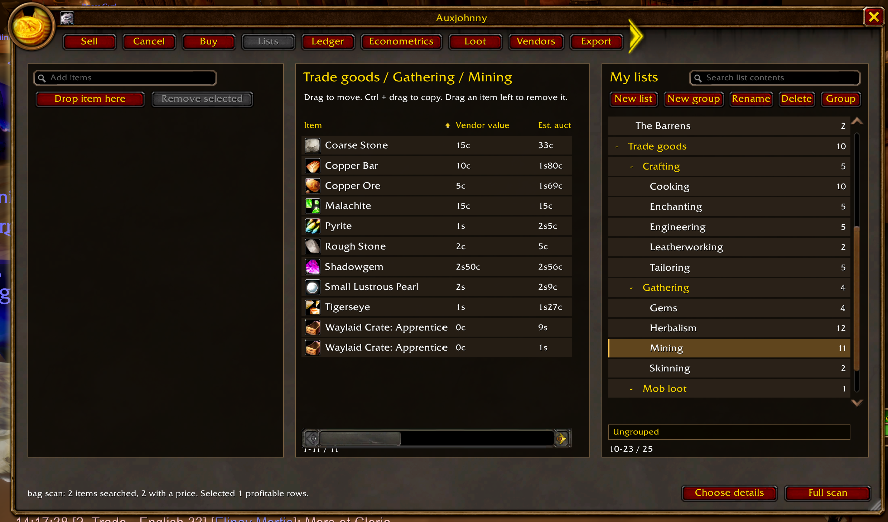
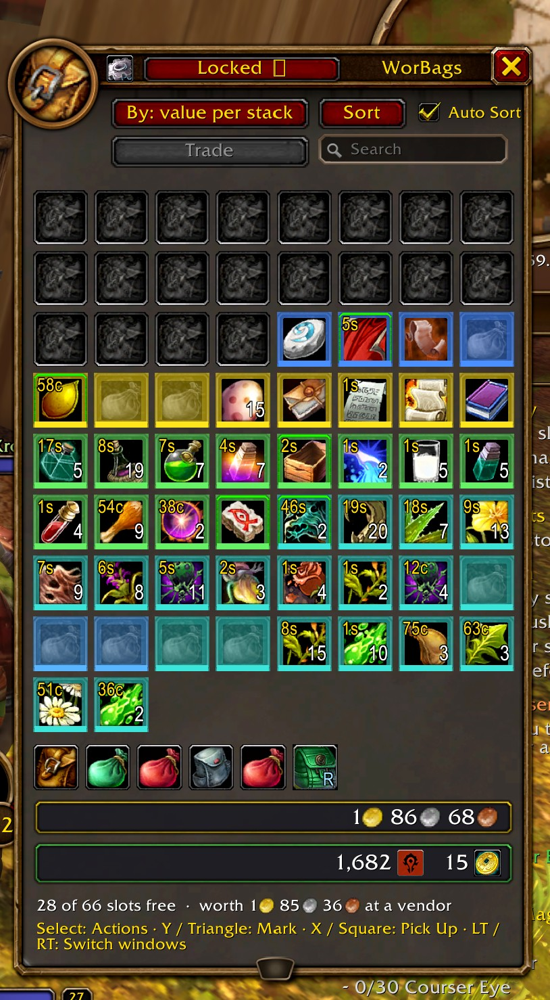
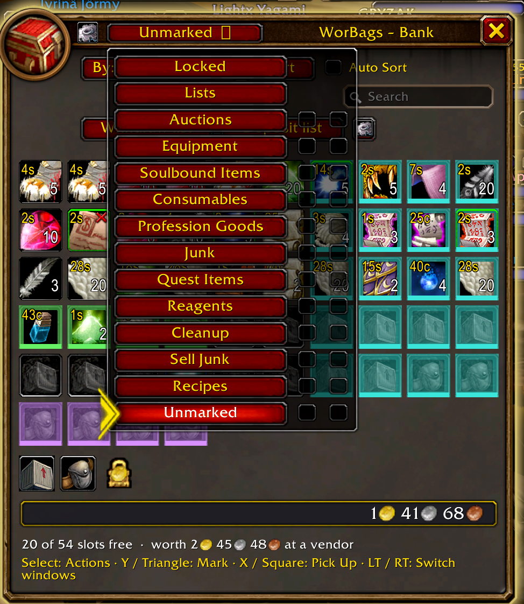
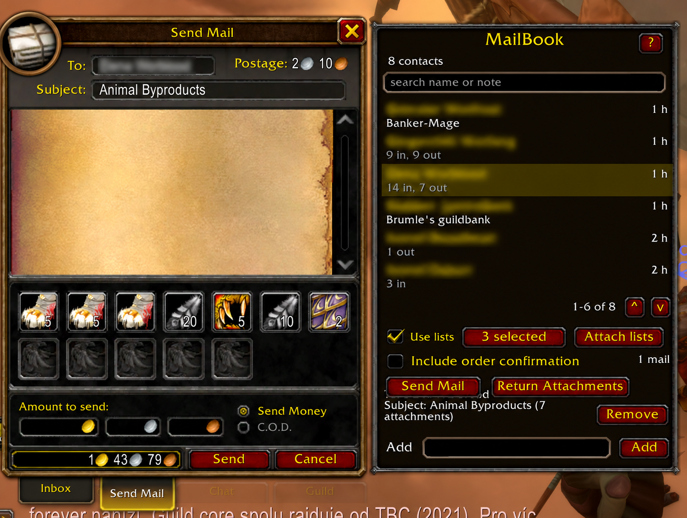

# WoW WorAddons

WoW WorAddons is a private, unreleased addon project for **WoW Forever**. It brings together gamepad-friendly tools for auction trading, inventory, mail, character finances, and everyday UI management.

The project also includes WorPad, WorBar, MacroHeal, MultiDebug, MinimapMenuForTitanPanel, TrackingForTitanPanel, ZoneForTitanPanel, RankMarker, CamSwitch, WorMacro, and MacNotchForTitanPanel. The three addons described below are the central focus of the trading and guild-sharing work.

This README is a public-facing overview. It contains no credentials, personal account information, private server details, or implementation secrets.

## Auxjohnny

Auxjohnny is the project's auction and trading hub.

### Lists

Lists organize items for crafting, supply planning, selling, buying, mailing, and guild coordination. Lists can be grouped, searched, sorted by useful item values, and shared selectively in a future guild workflow. The same item can belong to more than one list, which makes lists useful for overlapping professions and trade needs.

### Ledger

Ledger records purchases, sales, balances, auction activity, and character inventory snapshots. It is intended to make it easy to understand what each character owns and how each character's trading activity performs. A future guild-sharing layer could allow members to publish selected ledger summaries or inventory availability so guildmates can find items across participating characters without exposing unrelated private data.

### Econometrics

Econometrics stores and compares auction observations, vendor values, price history, and other market measurements. It provides the foundation for identifying profitable buy and sell opportunities and for sharing market intelligence with a guild. Shared results should retain their market, realm, timestamp, and source context.

Auxjohnny also includes supporting auction, vendor, loot, disenchant, and export features. These are intended to make the trading data more useful without requiring every character to manage the same information manually.

## WorBags

WorBags provides unified bag and bank windows with gamepad navigation, sorting, list-based organization, and inventory transfers. Its planned guild role is to use shared Auxjohnny lists to help members find, deposit, withdraw, and organize trade items consistently. Inventory sharing should always be opt-in and limited to the characters or item categories a member chooses.

## MailBook

MailBook is an address book and mail assistant for the mailbox. It manages contacts, attachments, and selected Auxjohnny lists for repeatable character-to-character transfers. In a guild workflow, it can help prepare list-based mail while keeping recipient selection and shared list membership explicit.

## Guild sharing through Discord

The long-term goal is to share selected trading data inside a guild through WoW Forever's Discord integration. Useful shared information may include:

- item lists and crafting or supply lists
- auction observations and market prices
- vendor values and price comparisons
- buy and sell opportunities
- selected inventory summaries
- trade requests and items available within the guild
- economic reports for a chosen time period

Sharing should be selective. Personal balances, complete character inventories, and unrelated data should remain private unless a member explicitly includes them. The addons should use a clear export/import format, with Discord acting as the guild communication channel rather than requiring addons to store Discord credentials.

## Roadmap

- Define a small, versioned export format for Auxjohnny lists, ledger summaries, and econometrics records.
- Add an explicit share preview so a member can review and remove fields before publishing.
- Add guild, realm, character, and private scopes for shared data.
- Connect approved exports to WoW Forever's Discord integration for guild distribution.
- Add import and merge tools with timestamps, market context, and conflict handling.
- Let WorBags consume shared item lists for optional inventory and bank organization.
- Let MailBook use approved shared lists for optional guild or character-to-character mail workflows.
- Add revocation and local backup support before imported data changes local records.

The sharing roadmap is planned and is not released yet.

## Project status

WoW WorAddons is under local development and testing. It is not an officially released addon package. Some features depend on what the WoW Forever client allows addons to do, especially while the gamepad UI is active.

## Repository layout

- `AddOns/` – addon source folders
- `shared/` – shared Lua files
- `docs/` – project and technical documentation
- `tests/` – syntax and mock tests
- `deploy.sh` – deployment helper for local testing

## Privacy and distribution

The project is intended for private guild use while the sharing design is being developed. Any future release should document exactly what is exported, where it is sent, how long it is retained, and how guild members can opt out.
